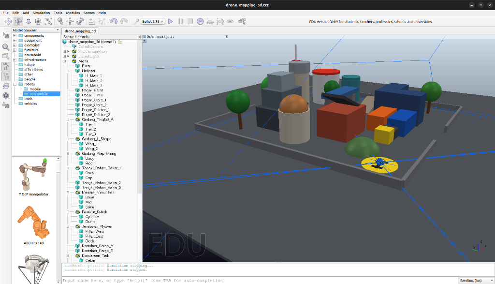

# 3D Mapping dengan Drone di CoppeliaSim

UTS Sistem Robot Otonom — I Made Windu Adi Pramana (5022241125)

Drone Quadcopter memetakan area kota mini berukuran 12 × 12 m. Drone membawa 4 kamera depth dan 1 LiDAR 2D 360°. Point cloud hasil scan difilter, dijadikan voxel, lalu diwarnai menurut ketinggian.



## Isi repositori

| Folder | Isi |
|---|---|
| `scene/` | `drone_mapping_3d.ttt` (scene CoppeliaSim), `ground_truth.json` |
| `lua/` | `drone_sensor.lua`, `drone_path.lua`, `drone_controller.lua` |
| `python/` | `build_scene.py`, `mission.py`, `recorder.py`, `live_view.py`, `postprocess.py`, `viewer_html.py`, `common.py` |
| `report/` | Laporan PDF |
| `results/` | Gambar hasil, `viewer_3d.html`, file PLY |

## Sensor

| Sensor | Arah | Yang dibaca |
|---|---|---|
| depthDown | tegak ke bawah | ground dan puncak objek |
| depthFront / Left / Right | depan, kiri, kanan, miring 35° ke bawah | badan (dinding) objek |
| lidar2D | horizontal 360° | irisan 2D di ketinggian drone |

## Menjalankan

Butuh CoppeliaSim 4.10 dan Python 3.10 dengan `numpy scipy matplotlib coppeliasim-zmqremoteapi-client`, serta `ffmpeg`.

```bash
./run_all.sh
```

Atau per langkah (CoppeliaSim sudah terbuka, port ZMQ 23000):

```bash
python3 python/build_scene.py --out scene/drone_mapping_3d.ttt
python3 python/mission.py --scene scene/drone_mapping_3d.ttt --plan smart --record-video results/video1_proses_mapping.mp4
python3 python/postprocess.py --input data/raw_scan.npz --gt scene/ground_truth.json --video
python3 python/viewer_html.py
```

Mode manual: `python3 python/mission.py --manual`, atau buka `.ttt` di GUI lalu tekan Play dan gerakkan drone dengan panah, W/S, A/D.

## Video

- Proses mapping (Video 1): https://drive.google.com/drive/folders/1uBtBkDtE1jU_nrwOPnV0bACt-iBPc62_?usp=drive_link
- Hasil 3D mapping (Video 2): https://drive.google.com/drive/folders/1qYjnifCYNH_WmO19mGRvYQcuMJOXFSfi?usp=drive_link

